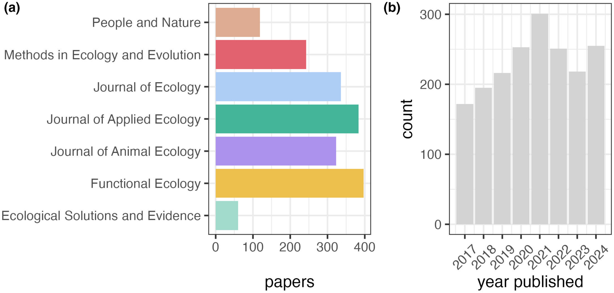
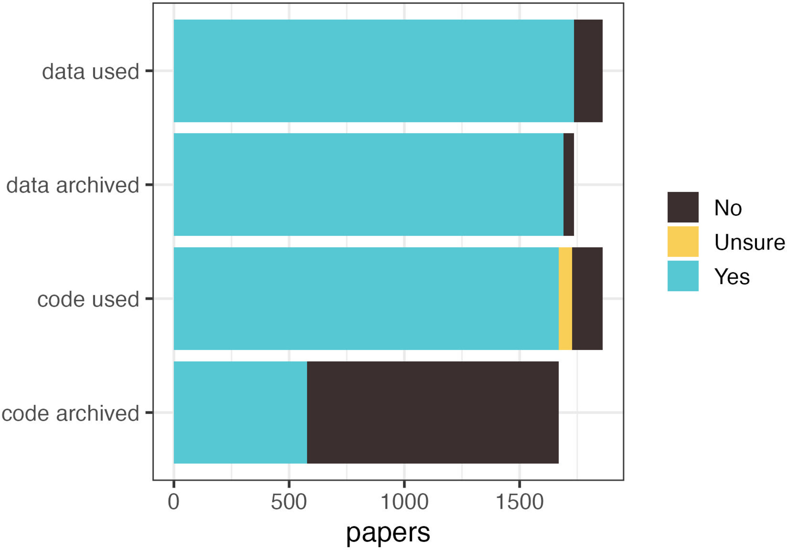
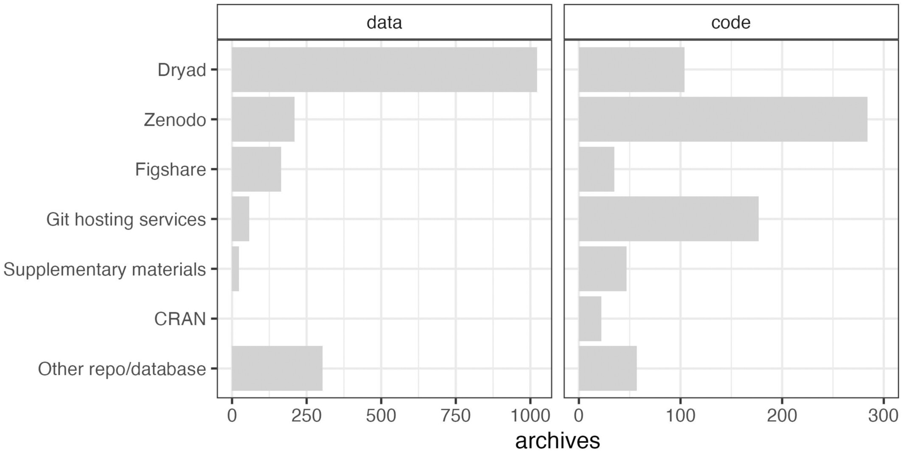
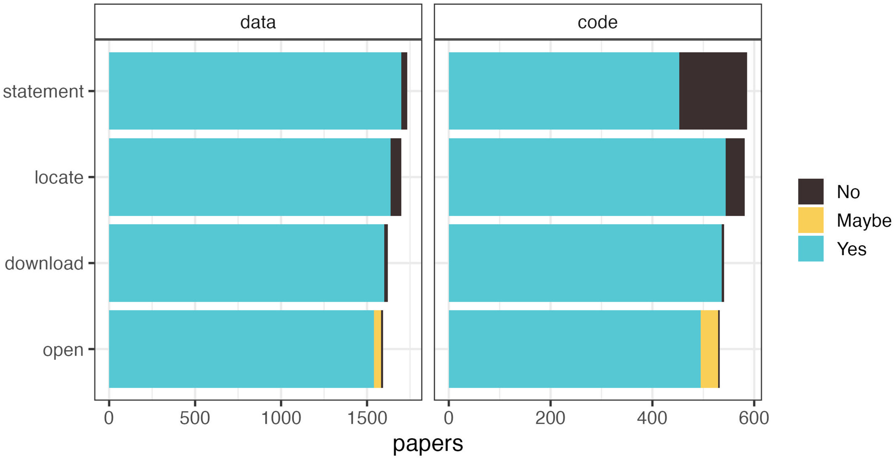
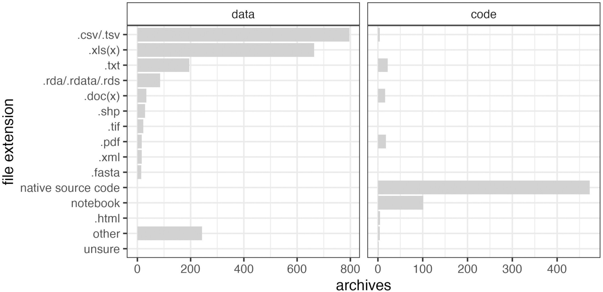
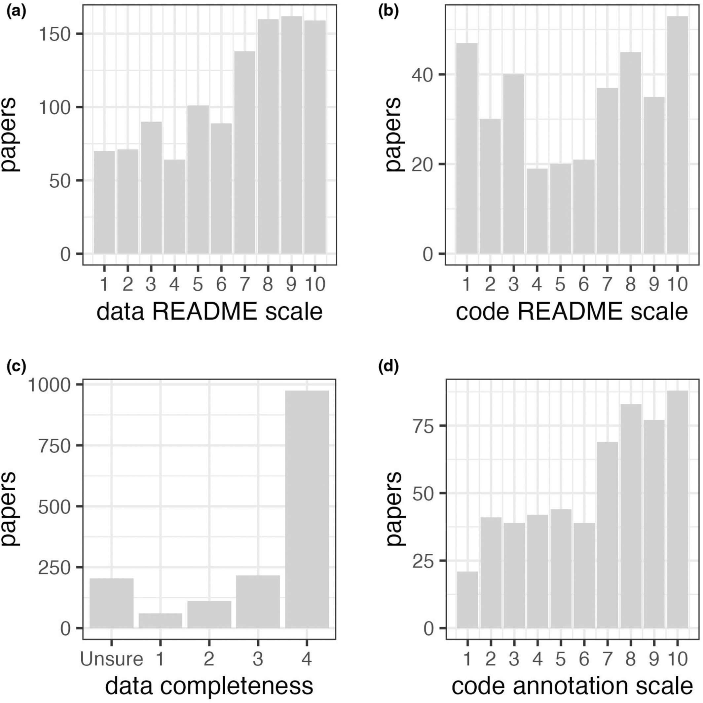

## Reproducibilty


::: {style="font-size: 40%;"}
The Turing Way Community. This illustration is created by Scriberia with
The Turing Way community, used under a CC-BY 4.0 licence. DOI:
10.5281/zenodo.3332807
:::

## 7 BES journals (2017 - 2024)

:::: {.columns}

::: {.column width="40%" style="font-size: 45%;"}
- Does the paper use data/code? If so, are they archived?
- Where were the data/code archived?
- Can the archived data/code be located, downloaded and opened?
- What file extensions do the archived data/code files use?
- Do the archived data/code have a README (or equivalent)? If so, how useful is it?
- How complete is the archived data?
- How good is the code annotation?
- Are the data/code citable?
:::

::: {.column width="50%"}

:::

::::

::: {style="font-size: 30%;"}
Cooper, N., & (2026). Data- and code-archiving in the British Ecological Society journals: Present status and recommendations for future improvements. Methods in Ecology and Evolution, 17, 1954–1966. https://doi.org/10.1111/2041-210x.70338
:::


## Is the data/code archived?

:::: {.columns}

::: {.column width="50%"}

:::

::: {.column width="50%"}

:::

::::

## Located, downloaded and opened?



## File extensions



## Readme




## Reviewed papers from 6 journals (2023-2025)

```{r}
#| label: setup
#| echo: false
#| eval: true

library(tidyverse)
library(readxl)
library(glue)
library(here)

```

```{r}
#| label: load-data
#| echo: false
#| eval: true
#| 
# Read data from all years and ensure consistent types
# Use here() to anchor paths at the project root during rendering
dat_2023 <- readxl::read_excel(here::here("data", "Reproducibility_2025.xlsx"), sheet = "Hjerkinn_2023") |>
  mutate(Year = "2023") |>
  # Convert logical columns to character
  mutate(across(where(is.logical), ~ if_else(is.na(.x), NA_character_, as.character(.x)))) |>
  # Convert Group to character (handles numeric, character, and NA)
  mutate(Group = as.character(Group))

dat_2024 <- readxl::read_excel(here::here("data", "Reproducibility_2025.xlsx"), sheet = "Hjerkinn_2024") |>
  mutate(Year = "2024") |>
  # Convert logical columns to character
  mutate(across(where(is.logical), ~ if_else(is.na(.x), NA_character_, as.character(.x)))) |>
  # Convert Group to character (handles numeric, character, and NA)
  mutate(Group = as.character(Group))

dat_2025 <- readxl::read_excel(here::here("data", "Reproducibility_2025.xlsx"), sheet = "Hjerkinn_2025") |>
  mutate(Year = "2025") |>
  mutate(across(where(is.logical), ~ if_else(is.na(.x), NA_character_, as.character(.x)))) |>
  mutate(Group = as.character(Group))

# Combine data first
dat_combined <- bind_rows(dat_2023, dat_2024, dat_2025)

# Combine and process data
dat_raw <- dat_combined |>
  select(Year, Group:Issue, `Is the data available?`, "Is the code to run the analysis for Fig/Tab x available?") |> 
  rename("data" = `Is the data available?`,
         "code" = "Is the code to run the analysis for Fig/Tab x available?") %>%
  mutate(Journal = tolower(Journal),
         Journal = if_else(Journal == "amrican naturalist", "american naturalist", Journal),
         # Handle empty strings and NA variations for Journal
         Journal = if_else(Journal == "" | Journal == "na" | Journal == "n/a", NA_character_, Journal),
         data = tolower(data),
         data = case_when(data == "na" | data == "n/a" ~ NA_character_,
                          data == "yes, but" ~ "yes",
                          TRUE ~ data),
         code = tolower(code),
         code = case_when(code == "na" | code == "n/a" ~ NA_character_,
                          code == "yea" ~ "yes",
                         TRUE ~ code),
         Year = factor(Year, levels = c("2023", "2024", "2025"))) |>
  # Filter out rows with missing Journal after processing
  filter(!is.na(Journal))

# Create long format for availability analysis
dat <- dat_raw |> 
  pivot_longer(cols = c(data, code), names_to = "variable", values_to = "availability") |> 
  mutate(variable = factor(variable, levels = c("data", "code"))) |> 
  filter(!availability %in% c("yes, but"))

# Precompute caption to avoid YAML parsing issues with !expr
fig_cap_papers <- glue::glue(
  "Number of papers reviewed in 2023: n = {nrow(dat_2023)}, 2024: n = {nrow(dat_2024)}, 2025: n = {nrow(dat_2025)}"
)

```

```{r}
#| label: fig-nr-papers
#| echo: false
#| eval: true
#| fig-cap: !expr fig_cap_papers


# Count papers by Year and Journal (years side-by-side per journal)
dat_raw |> 
  group_by(Year, Journal) |> 
  summarise(n = n(), .groups = "drop") |> 
  ggplot(aes(x = n, y = Journal, fill = Year)) +
  geom_col(position = position_dodge(width = 0.8), width = 0.75) +
  labs(x = "Number of papers", y = "") +
  theme_bw() +
  theme(legend.position = "bottom")

```


## 

### Data and code availability (2023–2025)

```{r}
#| label: fig-two
#| echo: false
#| eval: true
#| fig-cap: Data and code availability by year.

dat |> 
  group_by(Year, variable, availability) |> 
  summarise(n = n(), .groups = "drop") |> 
  ggplot(aes(x = variable, y = n, fill = availability)) +
  geom_col(position = "dodge") +
  facet_wrap(~ Year, ncol = 1) +
  labs(x = "", y = "Number of papers") +
  theme_bw() +
  theme(legend.position = "right")

```


## 

### 2023–2025: data and code availability by journal

```{r}
#| label: fig-three
#| echo: false
#| eval: true

dat |> 
  group_by(Year, Journal, variable, availability) |> 
  summarise(n = n(), .groups = "drop") |> 
  ggplot(aes(x = Journal, y = n, fill = availability)) +
  geom_col(position = "fill") +
  coord_flip() +
  labs(x = "", y = "Proportion") +
  facet_grid(variable ~ Year) +
  theme_bw() +
  theme(legend.position = "bottom")

```

## Exercise (1/2)

Make 6 groups.

Choose one of the following journals and select a random issue from 2026:

-   Methods in Ecology and Evolution

-   Journal of Ecology

-   OIKOS

-   American Naturalist

-   Journal of Animal Ecology

-   Ecological Monographs

## Exercise (2/2)

For each paper in this issue check:

- Is the **data available** and can you download it? Repo or supplement
file? In what format is the data available (xlsx, csv, txt, etc.)?

- Is the **code available**? Choose one figure/analysis. Is the data and code for this figure/analysis available? Try to run the code, can you replicate the figure/analysis.

- Add the data to this [google spreadsheet](https://docs.google.com/spreadsheets/d/1Rde3TsuFsExDmNNROZqslWVUOl_dXaLp4V-LnHq3Fyw/edit?gid=1921182395#gid=1921182395) and get a snack 🍪
