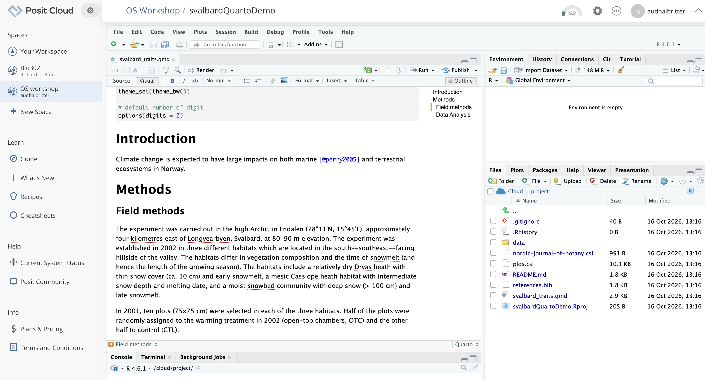
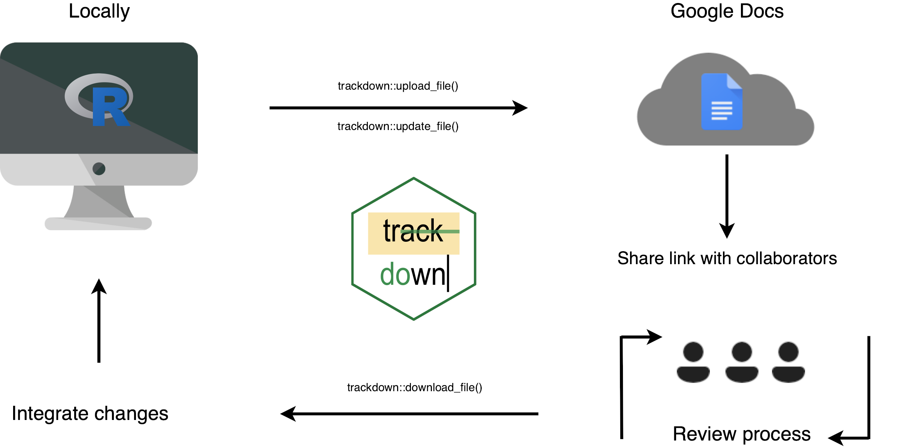
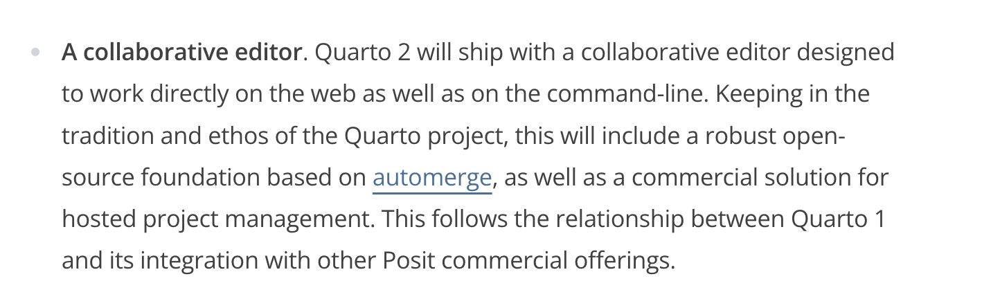

## {}

## {}

## {}

## Biostats tutorial

Go to this webpage: https://biostats-r.github.io/

## How to collaborate with others?

How do you get comments from co-authors?

## The manual way

- Render your mansucript to a word file.

- Share the file with co-authors for review.

- Manually add comments from co-authors to your qmd file.

## In an ideal world...

- Your co-authors fork the repo

- They read your manuscript (html version), make a PR with edits and comments.

- You check the PR, accept the changes you want, and merge the PR to your main branch.

But, co-authors rarely have the skills to do this...

## Alternative options - posit cloud

## Trackdown

## Quarto 2 might be the solution

